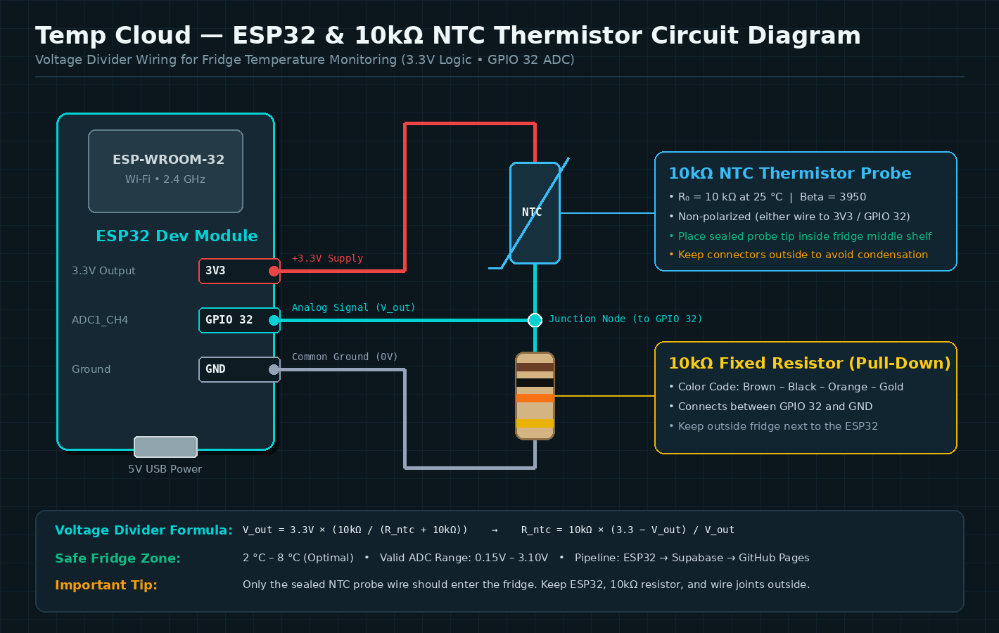

# Temp Cloud — ESP32 Fridge Temperature Monitor

Real-time IoT fridge temperature monitor powered by an **ESP32**, a **10kΩ NTC thermistor probe**, **Supabase**, and a mobile-friendly web dashboard hosted on **GitHub Pages**.

🌐 **Live Dashboard:** [https://youshae.github.io/fridge-monitor/](https://youshae.github.io/fridge-monitor/)

---

## 🔌 Circuit Diagram

### Wiring Summary

| Component | Pin / Connection | ESP32 Pin |
| :--- | :--- | :--- |
| **10kΩ NTC Thermistor Probe** | Wire 1 (non-polarized) | `3V3` (3.3V Output) |
| **10kΩ NTC Thermistor Probe** | Wire 2 (non-polarized) | `GPIO 32` (`ADC1_CH4`) |
| **10kΩ Fixed Resistor** *(Brown–Black–Orange–Gold)* | Leg 1 | `GPIO 32` (junction with probe) |
| **10kΩ Fixed Resistor** | Leg 2 | `GND` |

> **Tip:** Only the sealed thermistor probe tip should go inside the fridge (middle shelf, away from the door). Keep the ESP32, 10kΩ resistor, and any wire connectors outside the fridge so condensation cannot affect the readings.

---

## ✨ Features

* **Live Cloud Monitoring**: ESP32 reads the probe and pushes readings to Supabase via HTTPS REST API, with automatic multi-Wi-Fi failover (`WiFiMulti`).
* **Interactive Mobile Dashboard**:
  * **12 AM – 12 AM (24h)** day view, plus `1h`, `6h`, and `7d` history windows.
  * **Auto-scaling Y-axis** with highlighted **2 °C – 8 °C Safe Normal Zone**.
  * Touch/hover crosshair tooltips, **°C / °F** toggle, **Dark / Light** theme, and optional **> 8 °C** audible alarm.
  * **View Log Table** and **Export CSV** formatted in **Pakistan Standard Time (`Asia/Karachi`, PKT)**.
* **Installable Mobile Web App (iOS & Android)**: Includes custom icons and `manifest.json` for Add to Home Screen standalone mode.

---

## 📁 Repository Files

* [`index.html`](index.html) — Cloud web dashboard (hosted via GitHub Pages).
* [`firmware/fridge_logger.ino`](firmware/fridge_logger.ino) — ESP32 Arduino sketch with `WiFiMulti` support *(Wi-Fi credentials redacted for security — fill in your own SSID/password before flashing)*.
* [`circuit_diagram.png`](circuit_diagram.png) — ESP32 + 10kΩ NTC voltage divider wiring schematic.
* [`manifest.json`](manifest.json), [`apple-touch-icon.png`](apple-touch-icon.png), [`icon-192.png`](icon-192.png), [`icon-512.png`](icon-512.png), [`favicon.png`](favicon.png) — PWA manifest and mobile app icons.
